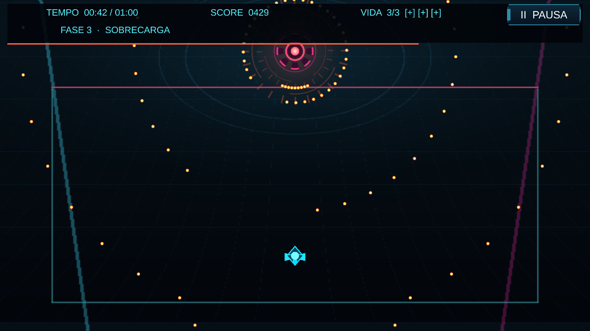

# Núcleo Instável

**Núcleo Instável** é um bullet hell 2D de sobrevivência. Em uma arena de neon, um drone precisa resistir por **60 segundos** aos disparos de um núcleo fora de controle.

A partida atravessa três fases de intensidade crescente, com anéis de projéteis, brechas em movimento e ataques mirados. O desafio está em reconhecer os padrões e encontrar espaço para passar.

## Como jogar

O objetivo é chegar ao fim do minuto com pelo menos uma das três vidas. O drone não atira: toda a ação depende do movimento e da esquiva.

O ponto claro no centro do drone indica a área que recebe dano. Segure o comando de precisão para reduzir a velocidade e atravessar passagens apertadas. Após um impacto, há um breve período de proteção.

Cada segundo sobrevivido vale pontos. Completar a partida rende um bônus pelas vidas restantes.

### Controles

| Ação | Teclado e mouse | Controle |
|---|---|---|
| Mover | WASD / setas | Analógico esquerdo |
| Precisão | Segurar Shift | Segurar LB |
| Pausar | P / Esc | Start |
| Navegar nos menus | Setas / mouse | Direcional / analógico |
| Confirmar | Enter / clique | A / botão sul |
| Voltar | Backspace | B / botão leste |

No navegador, use P para pausar; Esc pode sair da tela cheia.

## Executar o projeto

O projeto utiliza **Unity 6.3 LTS (6000.3.26f1)**.

1. Abra a pasta pelo Unity Hub e aguarde os pacotes.
2. Ative o novo Input System e reinicie o Editor se solicitado.
3. Abra `Assets/_NucleoInstavel/Scenes/Game.unity` e pressione Play.

Para reparar a cena, use **Tools → Nucleo Instavel → Create or Repair Project** fora do Play e depois **Validate Project**.

Para gerar uma versão de navegador, instale **WebGL Build Support** pelo Hub e use **Tools → Nucleo Instavel → Build WebGL**.

## Créditos

Desenvolvido em Unity, com arte geométrica e trilha sonora procedurais criadas para o jogo. Utiliza Input System, uGUI e TextMesh Pro, com a fonte Liberation Sans SDF. Os recursos de terceiros seguem suas respectivas licenças.
